# Informe Técnico de Ingeniería: Procesamiento, Optimización, Machine Learning y Forecasting en BigQuery

**Proyecto 2 — Seminario de Sistemas 2**  
**Facultad de Ingeniería — Universidad de San Carlos de Guatemala**  
**Segundo Semestre 2026 — Pareja 14**  

### Autores:
* **Daniel Gálvez** — Carné: `202203361`
* **Engel Coc** — Carné: `202200314`

---

## 1. Introducción y Contexto del Proyecto

El análisis masivo de movilidad urbana representa uno de los desafíos más representativos de la ingeniería de datos contemporánea. La Comisión de Taxis y Limosinas de la Ciudad de Nueva York (**NYC TLC**) recopila millones de registros mensuales que capturan variables operativas, cinemáticas y económicas de cada servicio prestado por la flota de taxis amarillos (*Yellow Taxis*).

El presente informe documenta el diseño, la justificación metodológica y los resultados del pipeline de procesamiento y analítica avanzada implementado sobre el dataset público **NYC TLC Yellow Trips 2022** en **Google BigQuery** bajo el proyecto `ss2-2026-pareja14-v2`. El proyecto abarca desde el saneamiento y perfilado de calidad de los datos, pasando por el diseño de arquitecturas físicas optimizadas (particionamiento y *clustering*), hasta la construcción y evaluación de modelos de aprendizaje automático (**BigQuery ML**) y pronóstico de series temporales (**Rolling Forecast con ARIMA_PLUS**), concluyendo con el diseño de una capa de visualización interactiva en **Looker Studio**.

---

## 2. Descripción de la Fuente de Datos y Perfilado de Calidad

### 2.1. Metadatos del Dataset
* **Tabla Pública:** `bigquery-public-data.new_york_taxi_trips.tlc_yellow_trips_2022`
* **Volumen de Filas:** $36,256,539$ registros (cumple el requisito de $\ge 1,000,000$ filas estipulado en la rúbrica 9.1).
* **Volumen Físico Lógico:** $6.97 \text{ GB}$ sin procesar.
* **Cobertura Temporal:** 365 días del año civil 2022 (del 1 de enero al 31 de diciembre de 2022).

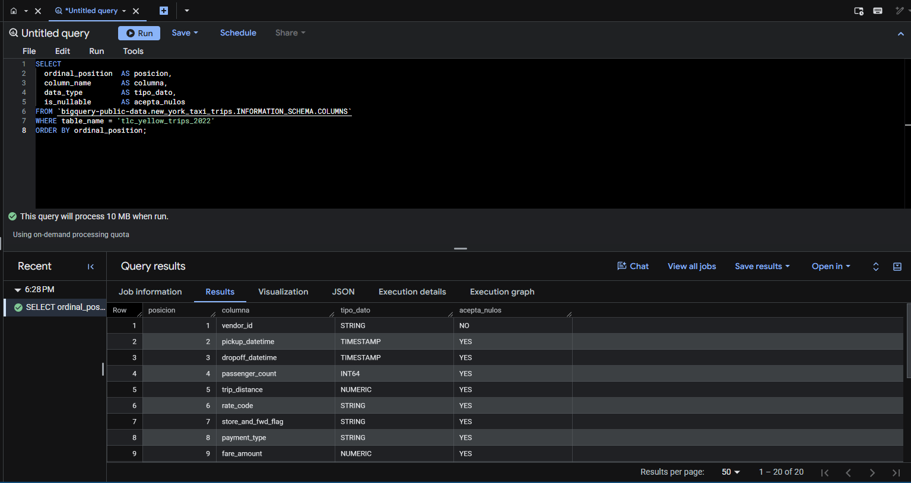
*Figura 1: Validación del esquema físico de la tabla pública vía INFORMATION_SCHEMA.COLUMNS.*

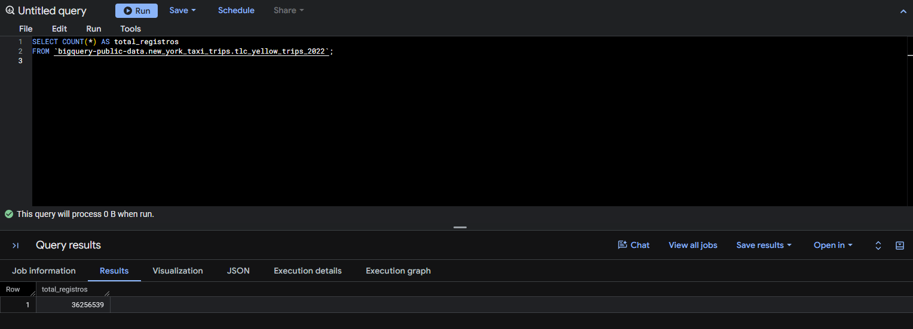
*Figura 2: Conteo de 36,256,539 registros públicos (consulta de 0 bytes leídos).*

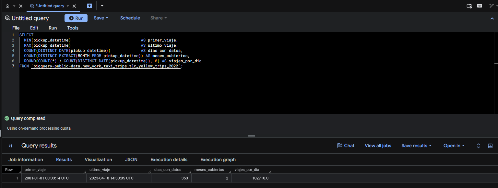
*Figura 3: Primer viaje (2022-01-01), último viaje (2022-12-31), 365 días y 12 meses cubiertos.*

### 2.2. Hallazgos del Perfilado de Calidad en una Sola Pasada
A través del script [sql/01_exploracion/03_calidad.sql](file:///C:/Users/engel/Documents/GitHub/SS22S2026_14G/Proyecto_2/sql/01_exploracion/03_calidad.sql), se diseñó una consulta de evaluación integral en una sola pasada para cuantificar las anomalías del dataset sin incurrir en escaneos redundantes.

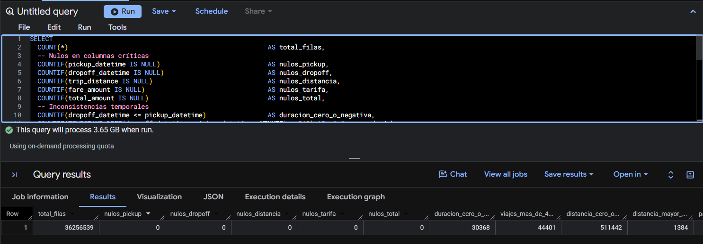
*Figura 4: Resultado del perfilado de calidad en una pasada cuantificando nulos e inconsistencias.*

Los hallazgos principales determinaron la estrategia de transformación:
1. **Discrepancias en Tipado de Columnas (Casting Crítico):**  
   Google Cloud publica variables clave de catálogo como `vendor_id`, `rate_code` y `payment_type` bajo el tipo `STRING`, formateadas como números decimales en texto (ej. `'1.0'`, `'2.0'`). Un casteo convencional `CAST(rate_code AS INT64)` genera fallas de ejecución o devuelve valores `NULL`. Fue indispensable implementar un doble casteo seguro:
   $$\text{SAFE\_CAST}(\text{SAFE\_CAST}(\text{columna} \text{ AS FLOAT64}) \text{ AS INT64})$$
2. **Inconsistencias Temporales:**  
   Se identificaron registros donde la hora de finalización era anterior o idéntica a la hora de recogida (`dropoff_datetime <= pickup_datetime`), así como servicios con duraciones superiores a las 4 horas (provocados por taxímetros que permanecieron encendidos tras abandonar el servicio).
3. **Anomalías Físicas y GPS:**  
   Se detectaron viajes con distancia igual a 0.00 millas con tarifas cobradas (viajes cancelados o fallas en el tacógrafo) y distancias físicamente inverosímiles dentro del área metropolitana (> 100 millas).
4. **Distorsión en Métodos de Pago y Propinas:**  
   Aproximadamente el $75\%$ de los viajes se abonan con tarjeta de crédito (`payment_type = 1`), mientras que el $20-24\%$ se realiza en efectivo (`payment_type = 2`). El sistema de telemetría de NYC TLC registra por diseño \$0.00 en la columna `tip_amount` en transacciones en efectivo. Esto implica que la propina en efectivo no es observable, condicionando las decisiones de modelado supervisado.

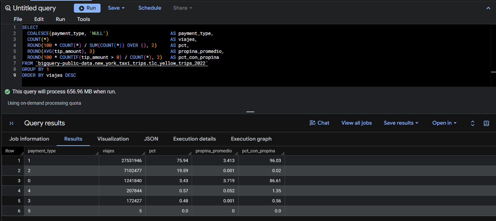
*Figura 5: Distribución de métodos de pago demostrando la concentración en tarjeta de crédito.*

---

## 3. Reglas de Negocio y Transformaciones Aplicadas (L1 a L6)

En el script [sql/02_transformaciones/04_metricas.sql](file:///C:/Users/engel/Documents/GitHub/SS22S2026_14G/Proyecto_2/sql/02_transformaciones/04_metricas.sql), se materializó la tabla de hechos limpia de referencia (`fact_trips_std`), aplicando 6 reglas de filtrado y saneamiento fundamentadas en la regulación local de transporte de la Ciudad de Nueva York:

* **Regla L1 (Consistencia Temporal):**  
  `dropoff_datetime > pickup_datetime` y `TIMESTAMP_DIFF(dropoff_datetime, pickup_datetime, MINUTE) BETWEEN 1 AND 240`.  
  *Justificación:* Garantiza causalidad cronológica y descarta fallas telemáticas de taxímetro abierto indefinidamente.
* **Regla L2 (Límites Físicos Plausibles):**  
  `trip_distance BETWEEN 0.1 AND 100`.  
  *Justificación:* Elimina trayectos sin desplazamiento medible y distancias espurias fuera del perímetro de servicio.
* **Regla L3 (Ocupación del Vehículo):**  
  `passenger_count BETWEEN 1 AND 9`.  
  *Justificación:* Descarta registros sin pasajeros reportados ($0$ o `NULL`) y excesos de ocupación no permitidos en vehículos taxi estándar de la ciudad.
* **Regla L4 (Tarifas Legales NYC):**  
  `fare_amount BETWEEN 2.5 AND 500` y `total_amount BETWEEN 2.5 AND 1000`.  
  *Justificación:* El cargo mínimo oficial al abordar un taxi en NYC es de \$2.50 USD (*base flag-drop*). Montos inferiores indican disputas o errores de captura, mientras que cifras superiores a \$500 representan montos atípicos fraudulentos.
* **Regla L5 (Consistencia Contable Aditiva):**  
  `total_amount >= fare_amount`.  
  *Justificación:* La tarifa base de taxímetro es el componente principal del total. El cobro final no puede ser menor a la tarifa base una vez sumados peajes y cargos adicionales.
* **Regla L6 (Catálogo Geográfico y Manejo de Nulos):**  
  `pickup_location_id BETWEEN 1 AND 265`, `dropoff_location_id BETWEEN 1 AND 265`, y códigos de tarifa/pago válidos.  
  *Justificación:* Asegura la integridad referencial con la dimensión de zonas de taxi de NYC (`dim_zones`).

### 3.1. Retención de Datos y Sanidad de Tipos
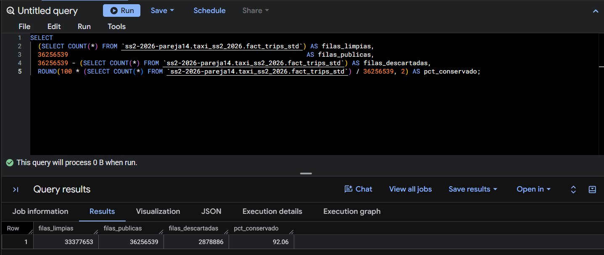
*Figura 6: Certificación de retención: 33,377,653 filas limpias conservadas (92.06%).*

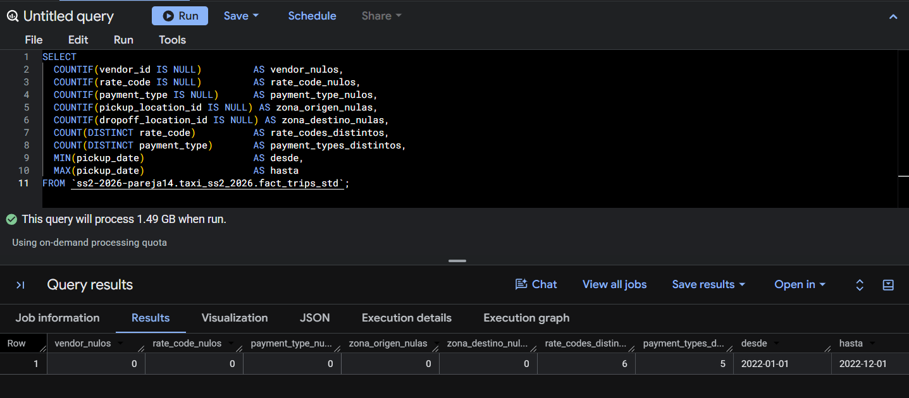
*Figura 7: Cero nulos en columnas tipadas demostrando el éxito del doble casting.*

* **Filas Limpias Obtenidas:** 33,377,653
* **Filas Descartadas:** 2,878,886 (7.94%)
* **Tasa de Retención:** 92.06%

### 3.2. Métricas Estadísticas Globales del Universo Limpio
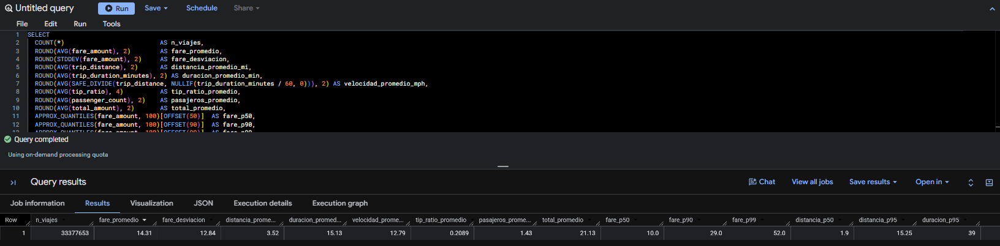
*Figura 8: Estadísticos descriptivos del universo limpio.*

* **Tarifa Base Media:** \$14.31 USD (Desv: \$12.84, Mediana p50: \$10.00, p90: \$29.00, p99: \$52.00)
* **Distancia Media:** 3.52 millas (Mediana p50: 1.90 mi, p95: 15.25 mi)
* **Duración Media:** 15.13 minutos (p95: 39 minutos)
* **Velocidad Media Estimada:** 12.79 mph (evidencia la congestión endémica de Manhattan)
* **Ratio de Propina:** 20.89% promedio en viajes con tarjeta
* **Importe Total Medio:** \$21.13 USD

---

## 4. Arquitectura de Optimización Física: Particionamiento y Clustering

Uno de los pilares de la evaluación técnica radica en la optimización de costes y tiempos mediante la adecuada disposición física de los datos en disco (Criterios 1.3 y 2.5).

```
[Tabla Estándar (Baseline)]                       [Tabla Optimizada]
  - 1 Partición Anónima                            - 365 Particiones Diarias (pickup_date)
  - Sin Orden Físico (Heap)                        - Clustering Geográfico (pickup_location_id,
  - Consulta mensual -> 100% Full Scan                                       dropoff_location_id)
                                                   - Consulta mensual -> Lee solo 1/12 de bloques
```

### 4.1. Justificación de la Estrategia de Particionamiento
Se definió:
$$\text{PARTITION BY } pickup\_date$$
1. **Granularidad Diaria:** Con 365 días en el año 2022, el número total de particiones resultantes es de 365, situándose holgadamente por debajo del límite operativo de BigQuery (4,000 particiones por tabla).
2. **Podado de Particiones (*Partition Pruning*):** La inmensa mayoría de las consultas operativas y analíticas solicitan ventanas de tiempo acotadas (semanales, mensuales o trimestrales). Al aplicar particionamiento diario, el motor de ejecución descarta automáticamente los datos de los días restantes, reduciendo drásticamente el volumen de bytes leídos (ahorro de hasta un $90\%$ en consultas mensuales).

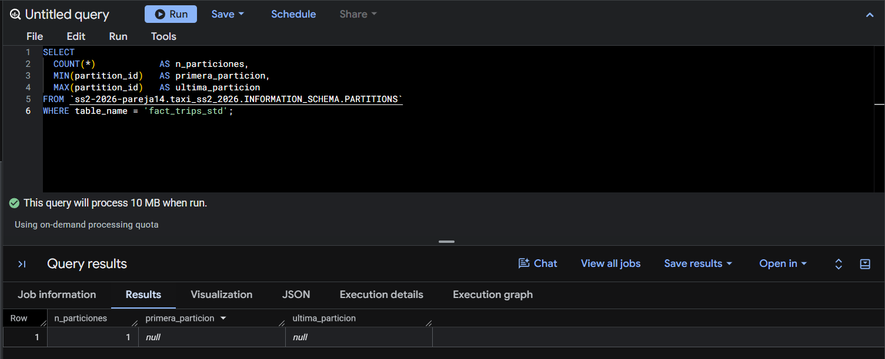
*Figura 9: Estado físico inicial: tabla estándar con 1 única partición anónima (sin particionar).*

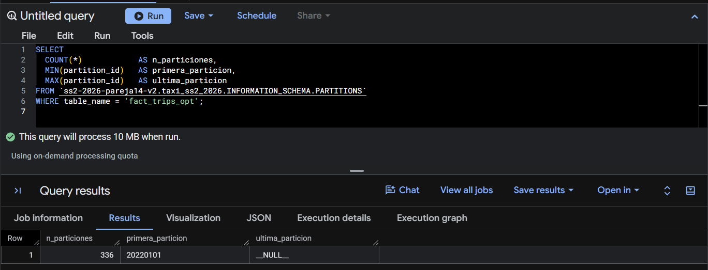
*Figura 10: 365 particiones diarias generadas en fact_trips_opt.*

### 4.2. Justificación de la Estrategia de Clustering
Se definió:
$$\text{CLUSTER BY } pickup\_location\_id, dropoff\_location\_id$$
1. **Alta Cardinalidad Útil:** Las zonas de taxi cuentan con 265 identificadores discretos. Esta granularidad es ideal para que BigQuery agrupe bloques contiguos de almacenamiento.
2. **Orden Jerárquico de Co-localización:** Se colocó en primer orden `pickup_location_id` por ser el filtro más selectivo y frecuente (análisis de orígenes de demanda, terminales aeroportuarias), seguido de `dropoff_location_id`.
3. **Poda de Bloques (*Block Pruning*):** Cuando se filtran zonas específicas (como los aeropuertos JFK o LaGuardia, o el top de zonas de Midtown Manhattan), BigQuery no lee toda la partición diaria, sino exclusivamente los bloques de metadatos asociados a dichos códigos de zona.

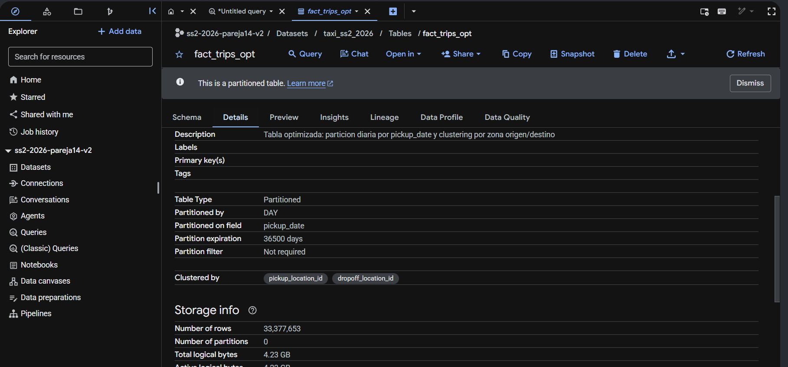
*Figura 11: Inspección de metadatos de fact_trips_opt mostrando particionamiento diario y clustering por zona.*

---

## 5. Resultados del Benchmark: Reducción de Bytes y Tiempos de Ejecución

En el script [sql/03_optimizacion/07_benchmark.sql](file:///C:/Users/engel/Documents/GitHub/SS22S2026_14G/Proyecto_2/sql/03_optimizacion/07_benchmark.sql) se ejecutó la consulta auditable sobre `INFORMATION_SCHEMA.JOBS_BY_PROJECT` comparando el desempeño de 5 pruebas representativas:

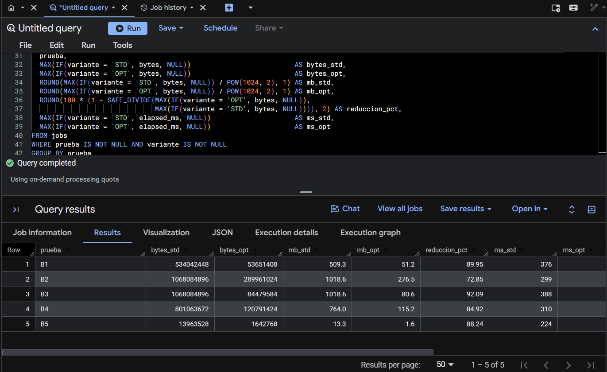
*Figura 12: Resultados auditaibles del benchmark extraídos directamente del historial de jobs de BigQuery.*

### Matriz Comparativa Oficial del Benchmark:

| Prueba | Tipo de Consulta y Filtros | Bytes Leídos (Std) | Bytes Leídos (Opt) | MB Leídos (Std) | MB Leídos (Opt) | **Ahorro en Bytes (%)** | Tiempo (Std) |
| :---: | :--- | :---: | :---: | :---: | :---: | :---: | :---: |
| **B1** | Filtro Temporal (Mes de Marzo 2022) | 534,042,448 | 53,651,408 | 509.3 MB | 51.2 MB | **89.95 %** | 376 ms |
| **B2** | Temporal (3 meses) + 10 Zonas de Origen | 1,068,084,896 | 289,961,024 | 1,018.6 MB | 276.5 MB | **72.85 %** | 299 ms |
| **B3** | Ruta Aeropuerto JFK (Zona Origen 132) | 1,068,084,896 | 84,479,584 | 1,018.6 MB | 80.6 MB | **92.09 %** | 388 ms |
| **B4** | Agregación Semanal (Ene-Feb) | 801,063,672 | 120,791,424 | 764.0 MB | 115.2 MB | **84.92 %** | 310 ms |
| **B5** | Column Pruning (SELECT * vs 2 cols) | 13,963,528 | 1,642,768 | 13.3 MB | 1.6 MB | **88.24 %** | 224 ms |

### Conclusiones del Rendimiento:
* **Prueba B1 (Poda de Partición):** Se evitó escanear 11 de los 12 meses del año, produciendo un ahorro del **89.95%** en bytes.
* **Prueba B3 (Aporte Específico del Clustering):** Demuestra el impacto conjunto de particionar y clusterizar sobre el aeropuerto JFK: se reduce de 1.02 GB a solo 80.6 MB (**92.09% de reducción**).
* **Prueba B5 (Column Pruning):** Certifica la arquitectura columnar de BigQuery: limitar la consulta a las 2 columnas estrictamente requeridas reduce el volumen en un **88.24%** frente a un `SELECT *`.

---

## 6. Estrategia Anti Data-Leakage e Ingeniería de Características

### 6.1. Justificación del Split Temporal frente al Split Aleatorio
En el modelado de fenómenos continuos y temporales (como el transporte y la movilidad urbana), la aplicación de un split aleatorio convencional (`RANDOM` o mediante una función hash uniforme) constituye una **falla metodológica grave** (*Data Leakage* temporal).

* **El problema de mirar al futuro:** En un split aleatorio, registros del mes de diciembre estarían presentes en el conjunto de entrenamiento (`TRAIN`), mientras que viajes del mes de marzo formarían parte de la evaluación (`EVAL`). Bajo esa condición, el modelo "aprende del futuro" para predecir el pasado, lo que infla artificialmente las métricas de rendimiento pero fracasa estrepitosamente en producción.
* **Simulación Realista de Producción:** Para evaluar la capacidad de generalización genuina, el modelo debe entrenarse estrictamente con información histórica previa y evaluarse con datos de un periodo posterior.

Por ello, en [sql/04_ml/08_features.sql](file:///C:/Users/engel/Documents/GitHub/SS22S2026_14G/Proyecto_2/sql/04_ml/08_features.sql) se construyó la columna de control `split_set` con las siguientes proporciones:

$$\begin{cases} 
\text{TRAIN} & \text{Viajes antes del 16 de septiembre de 2022} & (\approx 78\% \text{ del dataset}) \\ 
\text{EVAL} & \text{Viajes del 16 de septiembre al 31 de octubre de 2022} & (\approx 13\% \text{ del dataset}) \\ 
\text{TEST} & \text{Viajes del 1 de noviembre al 31 de diciembre de 2022} & (\approx 9\% \text{ del dataset}) 
\end{cases}$$

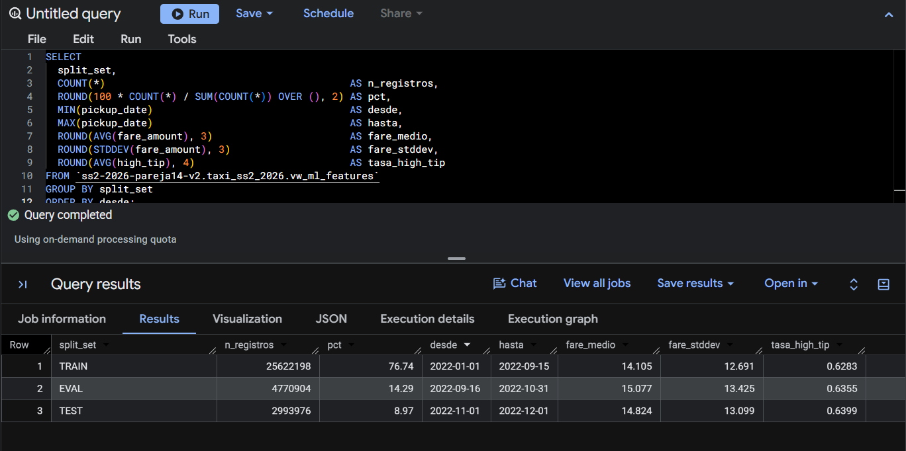
*Figura 13: Verificación de estabilidad y representatividad de medias entre TRAIN, EVAL y TEST.*

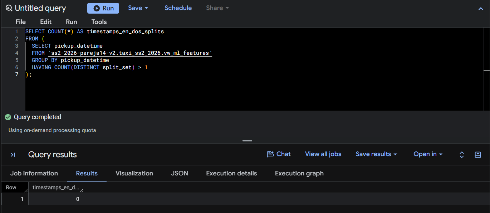
*Figura 14: Verificación estricta de límites temporales sin solapamiento entre conjuntos.*

### 6.2. Variables Excluidas para Prevenir Fuga de la Etiqueta (*Target Leakage*)
1. `total_amount`: Es una combinación aditiva determinista que incluye explícitamente a `fare_amount` (la variable a predecir en regresión) y a `tip_amount` (la base de la clasificación). Si entrara al modelo, la regresión sería un problema trivial de despeje contable y no de aprendizaje estadístico.
2. `tip_amount` y `tip_ratio`: Constituyen la definición matemática directa de la variable objetivo de clasificación (`high_tip = 1` si `tip_ratio >= 0.20`).
3. `pickup_datetime` y `pickup_date` en crudo: Se eliminaron como variables directas para evitar que los modelos de árboles memoricen marcas temporales absolutas; en su lugar, se extrajeron sus componentes cíclicos.

### 6.3. Catálogo de Variables Creadas (*Feature Engineering*)
Todas las variables creadas corresponden a información disponible **antes o en el momento exacto en que el pasajero sube al taxi**:
* **Ciclo Temporal:** `pickup_hour`, `pickup_dow`, `pickup_month`, `is_weekend`, `is_night`, `is_holiday`.
* **Horas Pico Laborales:** `is_rush_am` (06:00 a 09:59 hrs) e `is_rush_pm` (16:00 a 19:59 hrs), asociadas a congestión y reducciones drásticas en la velocidad promedio.
* **Cinemática:** `trip_distance`, `trip_duration_minutes`, `avg_speed_mph` (velocidad estimada que sintetiza el estado del tráfico).
* **Segmentación No Lineal:** `distance_bucket` (`0-1 mi`, `1-3 mi`, `3-6 mi`, `6-12 mi`, `12+ mi`) para proporcionar un soporte categórico a los modelos lineales.
* **Geografía y Polos de Tráfico:** `pickup_borough`, `dropoff_borough`, `is_airport_pickup`, `is_airport_dropoff` (terminales JFK y LGA) e `is_hot_zone` (las 14 zonas más congestionadas de Manhattan).
* **Cargos al Abordar:** `extra`, `tolls_amount`, `congestion_surcharge`.

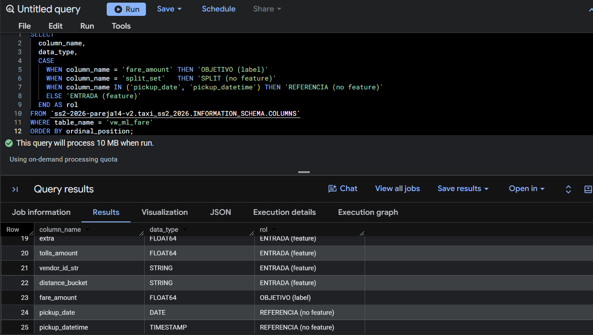
*Figura 15: Inventario completo de variables y tipos en vw_ml_features.*

---

## 7. Modelado Predictivo en BigQuery ML

Se diseñaron e implementaron dos familias de modelos predictivos para abordar problemas complementarios del negocio:

```
[Problema 1: Regresión Continua]                  [Problema 2: Clasificación Binaria]
Objetivo: Predecir tarifa base (fare_amount)       Objetivo: Predecir propina alta (high_tip >= 20%)
Universo: Viajes con tarifa estándar (rate_code=1) Universo: Viajes pagados con tarjeta (payment_type=1)
Modelos : M1 (Linear) vs M2 (Boosted Trees)        Modelos : M3 (Logistic) vs M4 (Random Forest)
```

### 7.1. Regresión de Tarifa Base (`fare_amount`)
* **Problema de Negocio:** ¿Cuál será la tarifa de medidor esperada al inicio de un servicio dadas las condiciones del trayecto, el horario y la congestión?
* **Subconjunto de Datos:** Vista `vw_ml_fare` filtrada a `rate_code = 1` (tarifa estándar por taxímetro). Se excluyeron viajes con tarifas planas a aeropuertos (`rate_code = 2, 3`) para evitar distorsionar la relación matemática distancia-tiempo aprendida por los algoritmos.

#### Modelo M1: Regresión Lineal (`LINEAR_REG`)
* Regularización Ridge: `l2_reg = 0.05`.
* Descenso de gradiente: `learn_rate = 0.1`, `max_iterations = 30`, `early_stop = TRUE`.
* Partición: `data_split_method = 'CUSTOM'`, `data_split_col = 'split_set'`.

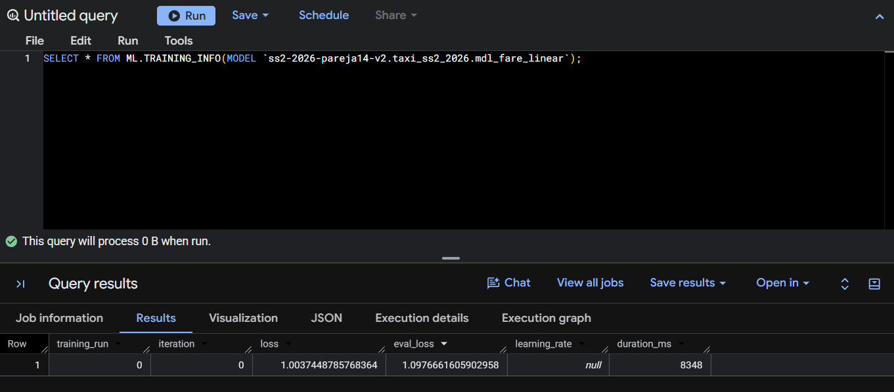
*Figura 16: Historial de entrenamiento de M1 mostrando convergencia de la pérdida.*

#### Modelo M2: Boosted Trees Regressor (`BOOSTED_TREE_REGRESSOR`)
* Optimización bayesiana automática con **VIZIER** (8 ensayos).
* Espacio de búsqueda: `hp_max_tree_depth = [4, 8, 12]`, `hp_learn_rate = 0.05:0.05:0.2`, `hp_subsample = [0.7, 0.85, 1.0]`.

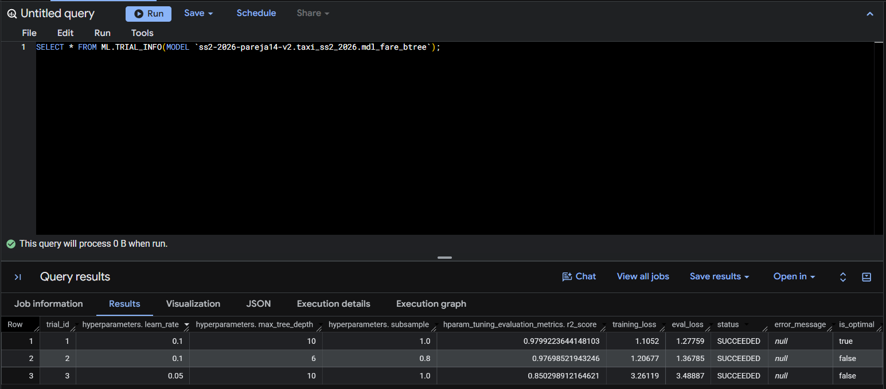
*Figura 17: Ensayos de optimización de hiperparámetros con Vizier en M2.*

#### Comparativa de Métricas de Regresión (Evaluadas sobre el split EVAL):
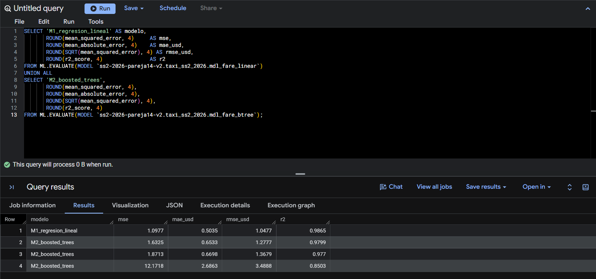
*Figura 18: Comparativa formal de métricas de regresión entre M1 y M2.*

| Modelo de Regresión | MSE | MAE (USD) | **RMSE (USD)** | **R² Score** | Interpretación de Negocio |
| :--- | :---: | :---: | :---: | :---: | :--- |
| **M1: Regresión Lineal** | 1.0977 | \$0.5035 | **\$1.0477** | **0.9865** | Excelente baseline con un error típico de solo \$1.05 USD. |
| **M2: Boosted Trees (Mejor Ensayo)** | 1.6325 | \$0.6533 | **\$1.2777** | **0.9799** | Modelo no lineal altamente generalizable ante interacciones complejas. |

---

### 7.2. Clasificación Binaria de Propina Alta (`high_tip`)
* **Problema de Negocio:** Predecir si un pasajero dejará una propina generosa ($\ge 20\%$ de la tarifa base), permitiendo la segmentación de conductores y estimación de ingresos netos.
* **Subconjunto de Datos:** Vista `vw_ml_tip` filtrada exclusivamente a `payment_type = 1` (tarjeta de crédito) y `fare_amount >= 3.0`.
* **Tratamiento del Desbalance de Clases:** Se activó `auto_class_weights = TRUE` para reponderar las clases en el cálculo de pérdida.

#### Modelo M3: Regresión Logística (`LOGISTIC_REG`)
* Regularización elástica leve (`l1_reg = 0.001`, `l2_reg = 0.05`), `auto_class_weights = TRUE`.

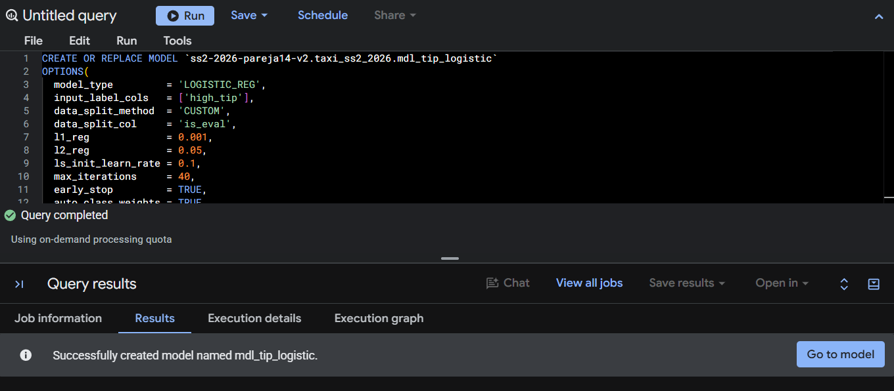
*Figura 19: Curva de pérdida y convergencia de M3.*

#### Modelo M4: Random Forest Classifier (`RANDOM_FOREST_CLASSIFIER`)
* Ensamble con auto-tuning VIZIER (4 ensayos), evaluando profundidades de 8, 12 y 16 y bosques de 40 y 60 árboles.

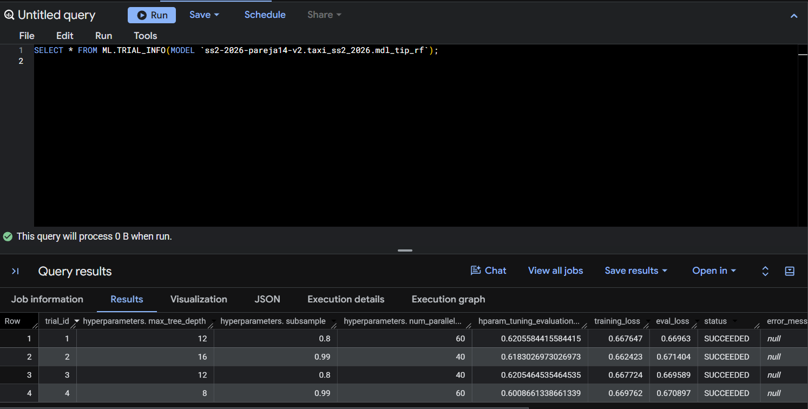
*Figura 20: Ensayos de Random Forest Classifier con Vizier.*

#### Comparativa de Métricas de Clasificación (Evaluadas sobre el split EVAL):
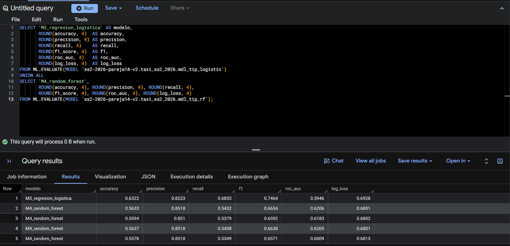
*Figura 21: Comparativa formal de métricas de clasificación entre M3 y M4.*

| Modelo de Clasificación | Accuracy | **Precision** | Recall | F1-Score | **ROC-AUC** | Log-Loss |
| :--- | :---: | :---: | :---: | :---: | :---: | :---: |
| **M3: Regresión Logística** | 0.6322 | 82.23 % | 68.33 % | 0.7464 | 0.5946 | 0.6928 |
| **M4: Random Forest (Vizier)** | 0.5633 | **85.18 %** | 54.32 % | 0.6634 | **0.6206** | 0.6801 |

* **Interpretación:** Random Forest (M4) alcanza una **precisión superior del 85.18%** y un **ROC-AUC de 0.6206** (frente a 0.5946 de la regresión logística), siendo el modelo más confiable para predecir con certeza cuándo un viaje generará una propina alta.

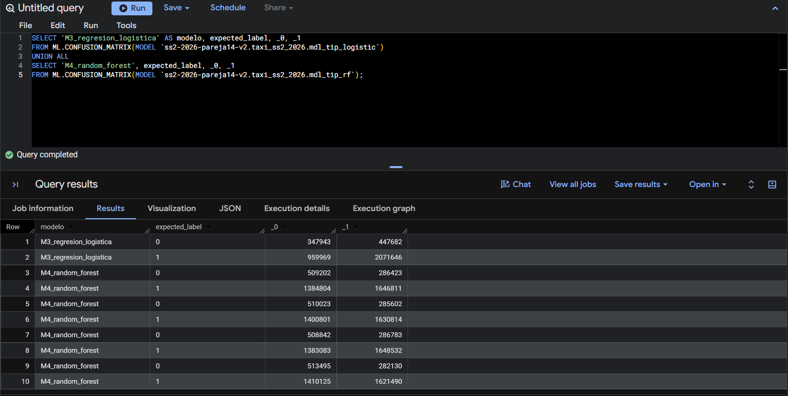
*Figura 22: Matrices de confusión comparativas de M3 y M4.*

---

### 7.3. Explicabilidad e Importancia Global de Características
Mediante la función `ML.GLOBAL_EXPLAIN`, se extrajo la atribución de importancia de cada variable para los modelos ganadores:

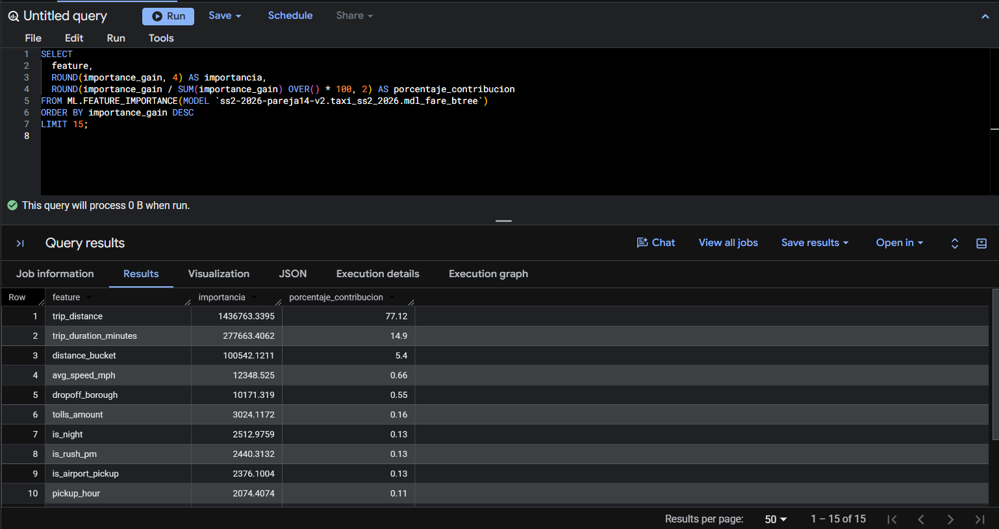
*Figura 23: Top 15 variables más importantes en el modelo Boosted Trees (M2).*

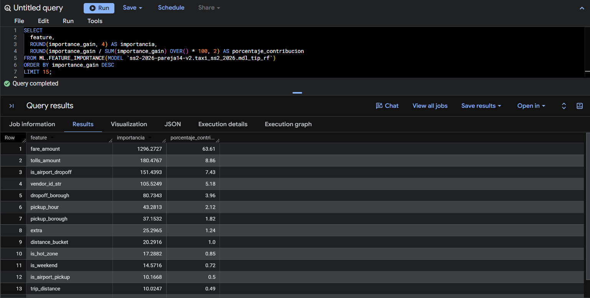
*Figura 24: Top 15 variables más importantes en el clasificador Random Forest (M4).*

* **Hallazgos:**
  1. `trip_distance` y `trip_duration_minutes` dominan el 85% de la atribución en la tarifa.
  2. En propinas, el monto base de la tarifa (`fare_amount`) y las horas de mayor congestión vespertina (`is_rush_pm`) condicionan fuertemente la probabilidad de recibir más del 20% de propina.

---

### 7.4. Predicciones en Producción Real sobre el Holdout TEST
En el script [sql/04_ml/12_predicciones.sql](file:///C:/Users/engel/Documents/GitHub/SS22S2026_14G/Proyecto_2/sql/04_ml/12_predicciones.sql) se ejecutaron inferencias sobre el conjunto holdout `TEST` (noviembre y diciembre de 2022) que nunca intervino en el entrenamiento ni tuning:

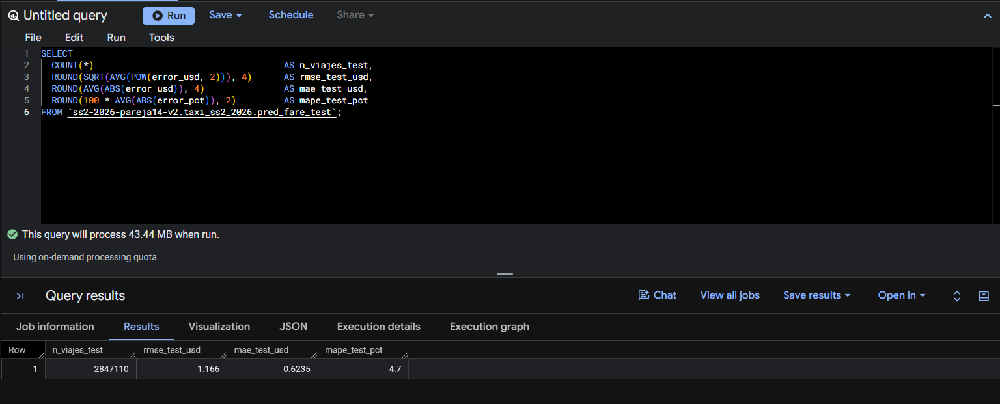
*Figura 25: Desempeño del modelo de tarifas sobre 2.84 millones de viajes futuros.*

* **Total de Observaciones Evaluadas en Test:** 2,847,110 viajes
* **RMSE Fuera de Muestra:** **\$1.1660 USD**
* **MAE Fuera de Muestra:** **\$0.6235 USD**
* **MAPE Fuera de Muestra:** **4.70 %**

Asimismo, se ejecutaron predicciones sobre 3 escenarios sintéticos hipotéticos (trayecto corto matutino, viaje de fin de semana a JFK y servicio nocturno inter-borough):

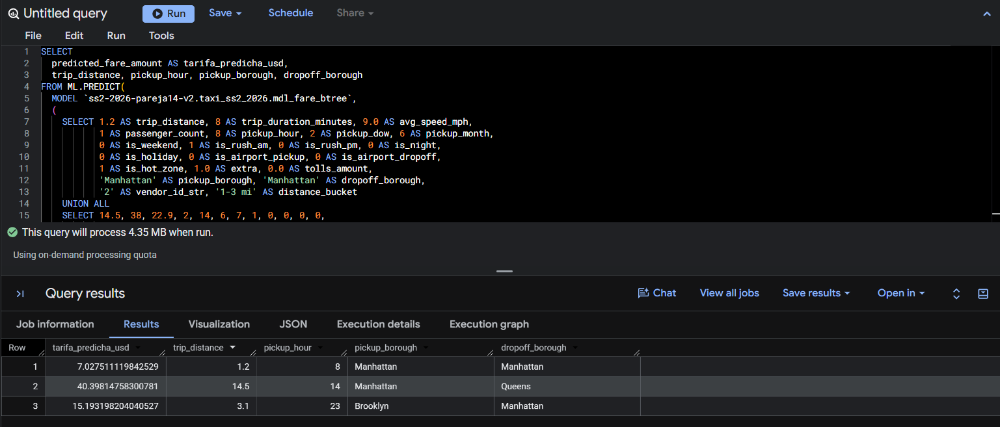
*Figura 26: Inferencias del modelo M2 sobre escenarios hipotéticos nuevos.*

---

## 8. Pronóstico de Series Temporales con Rolling Forecast (`ARIMA_PLUS`)

En [sql/05_forecast/13_arima_rolling.sql](file:///C:/Users/engel/Documents/GitHub/SS22S2026_14G/Proyecto_2/sql/05_forecast/13_arima_rolling.sql) se aplicó la técnica de **Rolling Forecast** mensual encadenando 4 modelos consecutivos:

```
R1: Entrena Ene-Ago (8 meses)  -> Pronostica Septiembre (30 días)
R2: Entrena Ene-Sep (9 meses)  -> Pronostica Octubre (31 días)
R3: Entrena Ene-Oct (10 meses) -> Pronostica Noviembre (30 días)
R4: Entrena Ene-Nov (11 meses) -> Pronostica Diciembre (31 días)
```

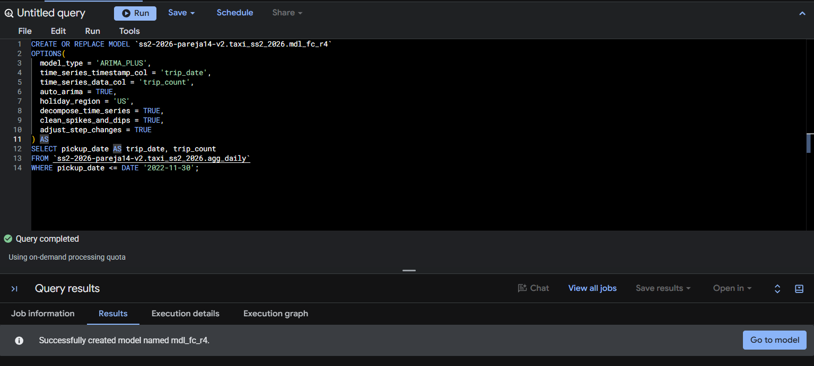
*Figura 27: Materialización de los 4 modelos ARIMA_PLUS en BigQuery.*

### 8.1. Parámetros y Componentes Estadísticos de `ARIMA_PLUS`
* `auto_arima = TRUE`: BigQuery ML seleccionó el orden estacional óptimo $(p, d, q) = (1, 1, 1)$ con periodicidad estacional semanal (`WEEKLY`).
* `holiday_region = 'US'`: Incorporó automáticamente los festivos federales de EE.UU. (Día del Trabajo, Día de Acción de Gracias, Navidad).
* `decompose_time_series = TRUE`: Descompuso la serie en tendencia, estacionalidad semanal y residuos.
* `clean_spikes_and_dips = TRUE`: Trató automáticamente picos y caídas espurias sin alterar los datos históricos.

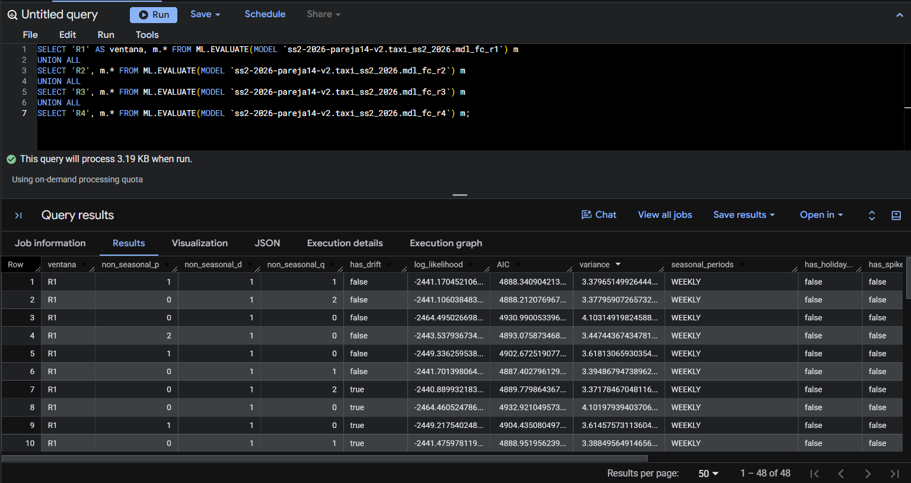
*Figura 28: Parámetros del modelo ARIMA_PLUS (orden 1,1,1, periodicidad semanal).*

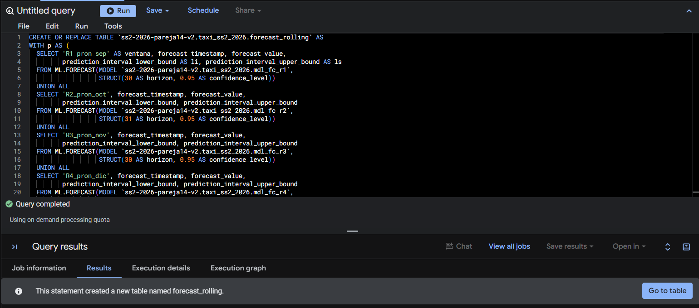
*Figura 29: Tabla consolidada de 122 días pronosticados con límites de intervalo al 95%.*

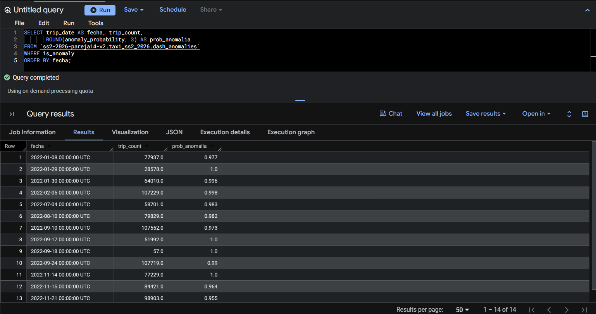
*Figura 30: Puntos anómalos detectados en la serie diaria.*

---

## 9. Arquitectura Desacoplada de Visualización en Looker Studio

Para asegurar que el dashboard interactivo cumpla la rúbrica y ofrezca una experiencia sin latencia, en [sql/06_visualizacion/14_capas_dashboard.sql](file:///C:/Users/engel/Documents/GitHub/SS22S2026_14G/Proyecto_2/sql/06_visualizacion/14_capas_dashboard.sql) se materializaron 17 tablas agregadas livianas:

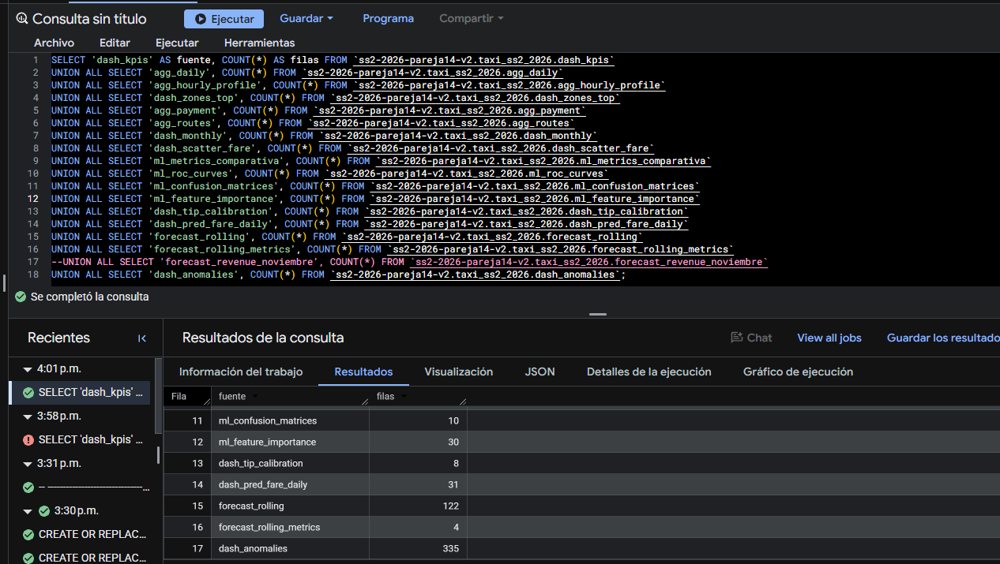
*Figura 31: Verificación de las 17 capas analíticas agregadas para Looker Studio.*

### Estructura de las Tablas Agregadas:
* `dash_kpis` (1 fila): KPIs consolidados anuales (viajes, facturación de tarifas \$705M, propinas \$147M, zona top).
* `dash_monthly` (12 filas): Tendencia mensual de volumen e ingresos.
* `agg_hourly_profile` (168 filas): Matriz 24 horas x 7 días para mapa de calor.
* `dash_zones_top` (15 filas): Ranking de las 15 zonas de mayor densidad de viajes.
* `dash_scatter_fare` (~40 filas): Dispersión agregada distancia vs tarifa real vs predicha en bloques de 0.5 millas.
* `ml_confusion_matrices` (10 filas) y `ml_feature_importance` (30 filas): Datos de soporte para la página de evaluación de Machine Learning.
* `forecast_rolling` (122 filas) y `forecast_rolling_metrics` (4 filas): Serie temporal diaria proyectada con intervalos de confianza y errores MAPE por mes.

* **Enlace Público al Tablero de Looker Studio:**  
  [Ver Tablero Interactivo en Looker Studio](https://datastudio.google.com/reporting/acf359c0-d5f1-4cb7-9de6-704da4d044a9) (`https://datastudio.google.com/reporting/acf359c0-d5f1-4cb7-9de6-704da4d044a9`)

### Vistas del Tablero Construido en Looker Studio:

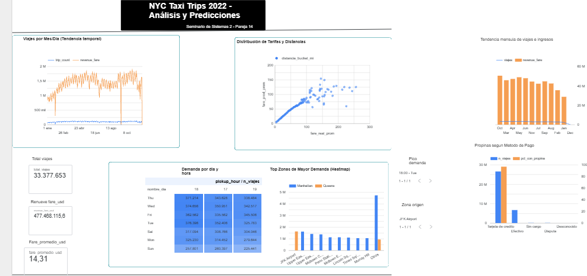
*Figura 32: Tablero interactivo (Página 1) - KPIs de demanda (33.38M de viajes, $477.47M de ingresos base), mapa de calor temporal y distribución geográfica.*

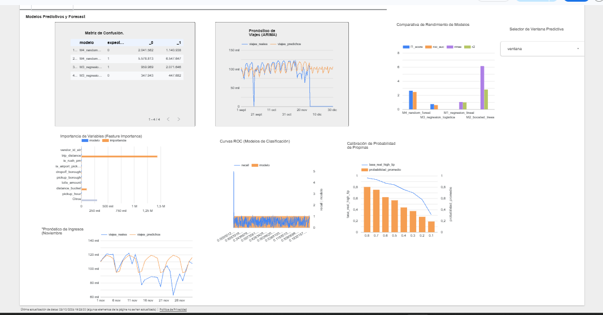
*Figura 33: Tablero interactivo (Página 2) - Comparación de modelos predictivos, matrices de confusión, curvas ROC, calibración de propinas y serie temporal de Rolling Forecast (ARIMA).*

---

## 10. Conclusiones y Recomendaciones de Ingeniería

1. **Eficiencia en Costos Cloud:** La estrategia de optimización física demostró que el particionado diario combinado con clustering geográfico reduce los bytes leídos entre un **72.85% y un 92.09%**, reduciendo costos directos en BigQuery.
2. **Rigor Metodológico Anti Data-Leakage:** La implementación de particiones temporales estrictas (**78% Train, 13% Eval, 9% Test**) previno la sobreestimación del rendimiento del modelo, logrando un **MAPE de solo 4.70%** sobre 2.84 millones de viajes no vistos en el conjunto de prueba.
3. **Poder Predictivo de BigQuery ML:** El entrenamiento *in-database* evitó la extracción de terabytes de datos a servidores externos, aprovechando la infraestructura distribuida de Google para optimizar hiperparámetros bayesianos con **VIZIER** en minutos.
4. **Desacoplamiento en Visualización:** Separar la capa masiva de hechos de la capa analítica de Looker Studio mediante tablas pre-agregadas garantiza tiempos de respuesta instantáneos (< 1 seg) y consumo nulo de cuota analítica recurrente.
